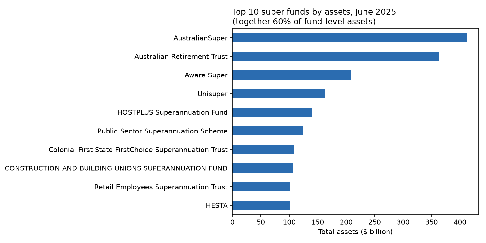

# Super Fund Data Quality Check (pandas, numpy)



## Problem
APRA publishes fund-level data on every APRA-regulated Australian super fund. I wanted to check if the data is reliable before using it for analysis.
I built repeatable data quality checks in pandas, flagged outliers with numpy, and reconciled the fund-level totals to APRA's official industry totals.

## Data
- APRA *Annual fund-level superannuation statistics*, back series June 2004 to June 2025 (fund tables 2a and 2b cover June 2014 to June 2025). Downloaded November 2026.
- APRA *Annual superannuation bulletin*, June 2015 to June 2025, superannuation entities. Used for reconciliation.
- Column meanings, units and raw-file layout: [data_dictionary.md](data_dictionary.md)

Both files are public under Creative Commons Attribution 3.0 Australia (© APRA).

## What I did
1. **Loaded messy government Excel files**: headers on row 4, form-reference and unit rows, footnote rows, `*` privacy masks, and data split across two sheets by balance date.
2. Cleaned **1,939 fund-year rows** (2014-2025) with code only: standard column names, removed footnote rows, recorded privacy masks *before* converting types, fixed types.
3. Built 10 data quality checks, each a True/False column. **15.8% of rows** fail at least one check (table below).
4. Found and fixed double counting: 4 funds that changed balance date appear twice in the same year, once in each table. Kept the latest record per ABN and period.
5. Flagged outliers with numpy: IQR on assets per member (skewed data, skew 2.6) and z-scores on expense ratios. Compared the two methods.
6. Reconciled to the official totals for every year from 2015 to 2025.

## Data quality results

| Check | Rows failed | % of rows | Verdict |
|---|---:|---:|---|
| any_masked_field | 249 | 12.8 | Expected: APRA privacy masks, mostly small funds |
| missing_assets | 248 | 12.8 | Expected: the same masked funds |
| avg_balance_mismatch | 33 | 1.7 | Fields disagree by more than 5%; needs investigation |
| expense_ratio_high | 23 | 1.2 | Tiny defined-benefit funds; ratios distorted |
| return_out_of_range | 13 | 0.7 | Same tiny funds (e.g. a -86% "return" on a few $m of assets) |
| dup_abn_period | 8 | 0.4 | Real issue: balance-date changes cause double counting |
| non_12_month_duration | 5 | 0.3 | Expected: returns not comparable |
| negative_assets | 0 | 0 | Passed |
| members_but_no_assets | 0 | 0 | Passed |
| missing_fund_type | 0 | 0 | Passed |

Flagged rows have a median of $49m in assets, against $2.2bn for clean rows, so the data issues are almost all in small funds.

## Reconciliation (June 2025, $ million)

| Fund type | My total | APRA bulletin | Gap |
|---|---:|---:|---:|
| Industry | 1,566,056 | 1,566,056 | 0.00% |
| Retail | 847,917 | 847,932 | -0.002% |
| Corporate | 36,484 | 36,484 | 0.00% |
| Public Sector | 595,201 | 773,051 | **-23.0%** |

- **Corporate** was 20.5% short using Table 2a alone. It matched exactly once Table 2b (funds with a non-30-June year end) was added.
- **Retail**: the $15m gap most likely comes from the 3 funds whose assets are masked.
- **Public Sector**: the gap is there every year: about 37% in 2015-2016 and 21-25% since 2017. APRA's notes say the fund-level report excludes exempt public sector superannuation schemes, which the bulletin includes. It's a coverage difference, not a data error.

## Findings
- **Concentration:** the top 10 of 77 funds hold 60% of fund-level assets. 8 funds hold half.
- **Consolidation:** the number of funds fell from 242 (2014) to 77 (2025), while assets rose from $1.1tn to $3.0tn.
- **Accounts:** member accounts fell from 28.0m (2015) to 21.3m (2021), likely linked to the Protecting Your Super reforms (2019) and COVID early release (2020), and have risen slightly since.
- **Costs vs returns:** across 68 comparable funds there's no meaningful link between total expense ratio and 5-year return (Spearman ρ = 0.16, Pearson r = 0.00). Funds with higher fees didn't get better returns.

| | |
|---|---|
|  |  |

## How to run
```bash
python -m venv .venv
source .venv/bin/activate        # Windows: .venv\Scripts\activate
pip install -r requirements.txt
jupyter notebook                 # run notebooks/01, 02, 03 in order
```
Notebook 02 writes `data/processed/*.csv`, which notebook 03 uses.

## Project structure
```
data/raw/          files exactly as downloaded (never edited)
data/processed/    fund_level_clean.csv, dq_summary.csv, reconciliation.csv
notebooks/         01_explore, 02_clean_and_checks, 03_analysis
images/            charts used in this README
data_dictionary.md
```

## What I'd do next
- Turn notebook 02 into a script that runs each year when APRA publishes, and stops with an error if too many rows fail a check.
- Investigate the 33 average-balance mismatches field by field.
- Add Table 6 (fees in dollars) for a fee analysis based on dollars instead of ratios.

## Tools
Python, pandas, numpy, matplotlib, Jupyter
