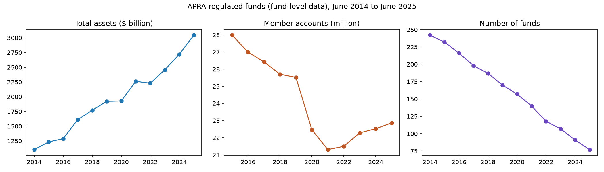
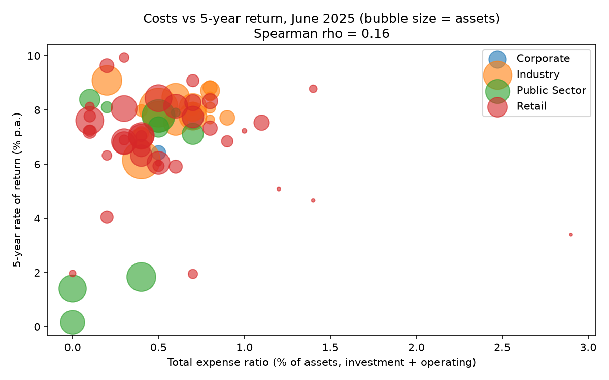
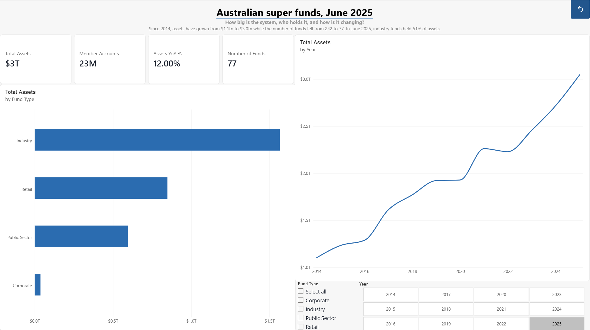
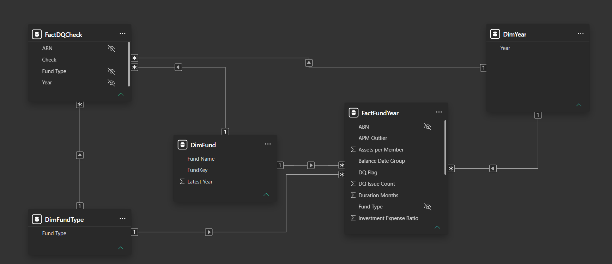
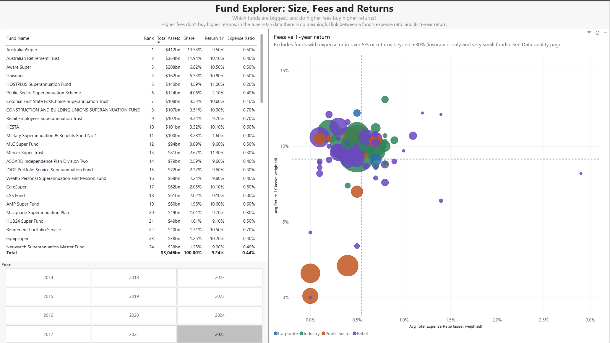
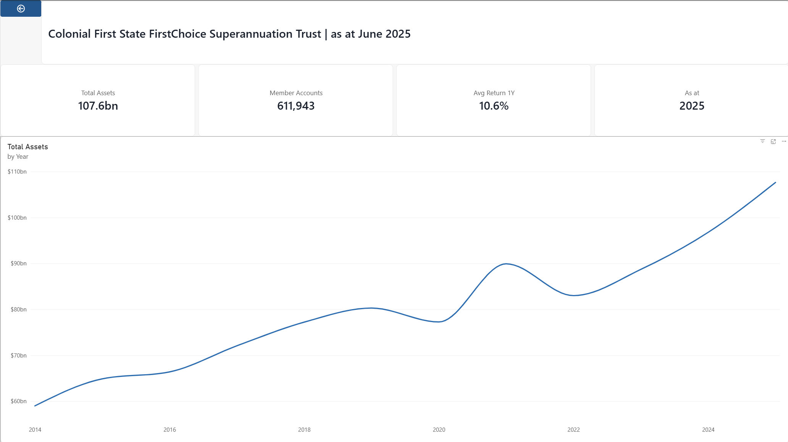
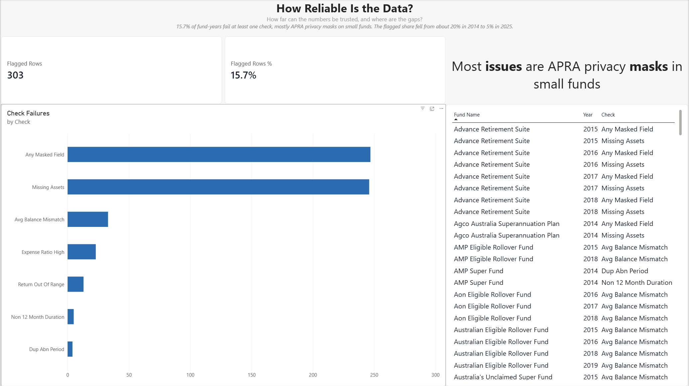
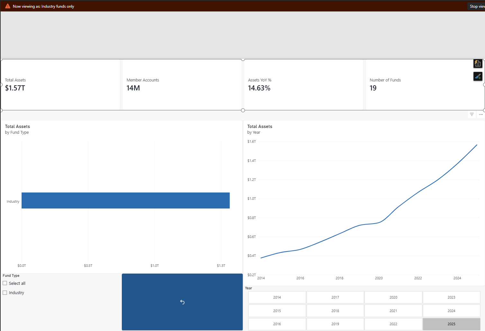

# Australian Super Funds: Data Quality Check and Power BI Dashboard

Two parts, one dataset (APRA fund-level data, June 2014 to June 2025):
1. **Data quality check in Python** (pandas, numpy): clean the raw APRA Excel, run 10 checks, reconcile to APRA's official totals.
2. **[Power BI dashboard](#part-2-power-bi-dashboard)**: a 4-page report on the clean output, with a star schema, DAX measures, drill-through and row-level security.


# Part 1: Data quality check (Python)

## Problem
APRA publishes fund-level data on every APRA-regulated Australian super fund. I wanted to check if the data is reliable before using it for analysis.
I built repeatable data quality checks in pandas, flagged outliers with numpy, and reconciled the fund-level totals to APRA's official industry totals.

## Data
- APRA *Annual fund-level superannuation statistics*, back series June 2004 to June 2025 (fund tables 2a and 2b cover June 2014 to June 2025). Downloaded November 2026.
- APRA *Annual superannuation bulletin*, June 2015 to June 2025, superannuation entities. Used for reconciliation.
- Column meanings, units and raw-file layout: [data_dictionary.md](data_dictionary.md)

Both files are public under Creative Commons Attribution 3.0 Australia (© APRA).

## What I did
1. **Loaded messy government Excel files**: headers on row 4, form-reference and unit rows, footnote rows, `*` privacy masks, and data split across two sheets by balance date.
2. Cleaned **1,939 fund-year rows** (2014-2025) with code only: standard column names, removed footnote rows, recorded privacy masks *before* converting types, fixed types.
3. Built 10 data quality checks, each a True/False column. **15.8% of rows** fail at least one check (table below).
4. Found and fixed double counting: 4 funds that changed balance date appear twice in the same year, once in each table. Kept the latest record per ABN and period.
5. Flagged outliers with numpy: IQR on assets per member (skewed data, skew 2.6) and z-scores on expense ratios. Compared the two methods.
6. Reconciled to the official totals for every year from 2015 to 2025.

## Data quality results

| Check | Rows failed | % of rows | Verdict |
|---|---:|---:|---|
| any_masked_field | 249 | 12.8 | Expected: APRA privacy masks, mostly small funds |
| missing_assets | 248 | 12.8 | Expected: the same masked funds |
| avg_balance_mismatch | 33 | 1.7 | Fields disagree by more than 5%; needs investigation |
| expense_ratio_high | 23 | 1.2 | Tiny defined-benefit funds; ratios distorted |
| return_out_of_range | 13 | 0.7 | Same tiny funds (e.g. a -86% "return" on a few $m of assets) |
| dup_abn_period | 8 | 0.4 | Real issue: balance-date changes cause double counting |
| non_12_month_duration | 5 | 0.3 | Expected: returns not comparable |
| negative_assets | 0 | 0 | Passed |
| members_but_no_assets | 0 | 0 | Passed |
| missing_fund_type | 0 | 0 | Passed |

Flagged rows have a median of $49m in assets, against $2.2bn for clean rows, so the data issues are almost all in small funds.

## Reconciliation (June 2025, $ million)

| Fund type | My total | APRA bulletin | Gap |
|---|---:|---:|---:|
| Industry | 1,566,056 | 1,566,056 | 0.00% |
| Retail | 847,917 | 847,932 | -0.002% |
| Corporate | 36,484 | 36,484 | 0.00% |
| Public Sector | 595,201 | 773,051 | **-23.0%** |

- **Corporate** was 20.5% short using Table 2a alone. It matched exactly once Table 2b (funds with a non-30-June year end) was added.
- **Retail**: the $15m gap most likely comes from the 3 funds whose assets are masked.
- **Public Sector**: the gap is there every year: about 37% in 2015-2016 and 21-25% since 2017. APRA's notes say the fund-level report excludes exempt public sector superannuation schemes, which the bulletin includes. It's a coverage difference, not a data error.

## Findings
- **Concentration:** the top 10 of 77 funds hold 60% of fund-level assets. 8 funds hold half.
- **Consolidation:** the number of funds fell from 242 (2014) to 77 (2025), while assets rose from $1.1tn to $3.0tn.
- **Accounts:** member accounts fell from 28.0m (2015) to 21.3m (2021), likely linked to the Protecting Your Super reforms (2019) and COVID early release (2020), and have risen slightly since.
- **Costs vs returns:** across 68 comparable funds there's no meaningful link between total expense ratio and 5-year return (Spearman ρ = 0.16, Pearson r = 0.00). Funds with higher fees didn't get better returns.

| | |
|---|---|
|  |  |


# Part 2: Power BI dashboard



A 4-page report built on `data/processed/fund_level_clean.csv` (the output of notebook 02): 250 funds, 1,935 fund-years.

**Question it answers:** who holds Australia's super assets, how is that changing, do higher fees buy higher returns, and how far can the data be trusted?

## Data model


| Table | Grain / role |
|---|---|
| FactFundYear | One row per fund per year: assets, accounts, returns, expense ratios, DQ flag |
| FactDQCheck | One row per failed check per fund-year (the 10 check columns unpivoted) |
| DimFund | One row per fund (ABN). Name taken from the latest year, because 5 funds were renamed |
| DimFundType | Industry, Retail, Public Sector, Corporate |
| DimYear | One row per year (DAX table) |

Design decisions:
- **Staging query with load disabled.** `FundYearStaging` reads the CSV once; the facts and dimensions reference it. The CSV path is a `DataFolder` parameter, so the report can be pointed at another folder in one place.
- **Types set explicitly.** Power Query's automatic type detection only looks at the first 200 rows. It read `Balance Date Group` ("30 June" / "Other") as a date and errored on "Other". I fixed it at the type step and set every type myself.
- **One row per fund per year.** The query keeps `is_primary_record` only, so the 4 duplicate fund-years from Part 1 aren't double counted.
- **Fund type sits on the fact, not on DimFund.** 5 funds changed type over the period, so each year keeps its own type.
- **All relationships many-to-one, single direction.** Filters flow from dimensions to facts only. No ambiguous paths, and row-level security flows to both facts.

## Measures
Full DAX with comments: [powerbi/dax/measures.dax](powerbi/dax/measures.dax). Power Query: [powerbi/powerquery/](powerbi/powerquery/). `PandasCleaning.m` is a practice query that repeats part of notebook 02's cleaning on the raw Excel; it isn't used by the report.

| Measure | What it does / why |
|---|---|
| Total Assets, Member Accounts, Number of Funds | SUM, SUM, DISTINCTCOUNT |
| Assets Prior Year, Assets YoY % | CALCULATE swaps the year filter for year - 1 |
| Share of Total Assets | ALL(DimFund) removes only the fund filter, so slicers still apply |
| Fund Rank by Assets | RANKX over all funds, blank on totals |
| Avg Return 1Y / Avg Total Expense Ratio (asset weighted) | SUMX(value × assets) / assets, only over funds that report the value, so masked funds don't drag the average down |
| Total Assets / Member Accounts / Avg Return 1Y (latest year) | For the drill-through page: shows the fund's last reported year instead of summing balances across years |
| Flagged Rows, Flagged Rows %, Check Failures | Data quality page |
| Overview Subtitle, Fund Detail Title | Dynamic page titles: the selected year on the Overview, the drilled fund and its latest year on Fund detail |

## Pages
| Page | Question | Notes |
|---|---|---|
| Overview | How big is the system and how is it growing? | Year slicer is single select, because assets are a balance and summing years double counts. The line chart ignores the year slicer (Edit interactions) so it always shows the full trend. Reset button uses a bookmark to go back to 2025 (a "clear slicers" button would leave no year selected). |
| Fund explorer | Which funds are biggest, and do higher fees buy higher returns? | Scatter of fees vs return, bubble = assets, with average lines. Excludes insurance-only and tiny funds (expense ratio over 5% or returns beyond ±30%), stated on the page. Hover shows a tooltip page; rank there is within the fund's type. |
| Fund detail | What does one fund look like over time? | Drill-through from page 2. "Keep all filters" is off so only the fund is passed, not the year. |
| Data quality | How far can the numbers be trusted? | 303 of 1,935 fund-years (15.7%) fail at least one check. Not filtered by year, because data quality is a property of the whole dataset and most issues are in earlier years. |

| Fund explorer | Fund detail (drill-through) |
|---|---|
|  |  |



## Row-level security
Role `Industry funds only` filters DimFundType to Industry, and the filter flows one way to both fact tables. Tested with *View as*: June 2025 shows 19 funds and $1,566.1bn, which matches the Industry total in the Part 1 reconciliation to the APRA bulletin.



## Performance
Performance Analyzer, second refresh (warm cache):
- Overview: every visual under 250 ms. DAX query time was about 10 ms per visual. Most time was "Other", which is visuals waiting their turn, so the lever is fewer visuals per page, not faster DAX.
- Fund explorer: slowest visual was the table at 209 ms, of which DAX was 15 ms and drawing was 115 ms. RANKX isn't a problem at this size. At a larger scale I'd limit the table with a Top N filter or precompute the rank upstream.

## How to open
1. Open `powerbi/super-fund-dashboard.pbix` in Power BI Desktop.
2. Transform data > Manage Parameters > set `DataFolder` to this repo's `data\processed\` folder (ending with `\`).
3. Close & Apply.

# Running Part 1

## How to run
```bash
python -m venv .venv
source .venv/bin/activate        # Windows: .venv\Scripts\activate
pip install -r requirements.txt
jupyter notebook                 # run notebooks/01, 02, 03 in order
```
Notebook 02 writes `data/processed/*.csv`, which notebook 03 uses.

## Project structure
```
data/raw/          files exactly as downloaded (never edited)
data/processed/    fund_level_clean.csv, dq_summary.csv, reconciliation.csv
notebooks/         01_explore, 02_clean_and_checks, 03_analysis
images/            charts used in this README (images/powerbi/ for the dashboard)
powerbi/           super-fund-dashboard.pbix, powerquery/*.m, dax/*.dax, theme/
data_dictionary.md
```

## What I'd do next
- Turn notebook 02 into a script that runs each year when APRA publishes, and stops with an error if too many rows fail a check.
- Investigate the 33 average-balance mismatches field by field.
- Add Table 6 (fees in dollars) for a fee analysis based on dollars instead of ratios.
- Publish the report to the Power BI service with scheduled refresh when APRA releases new data.

## Tools
Python, pandas, numpy, matplotlib, Jupyter, Power BI Desktop, Power Query (M), DAX
